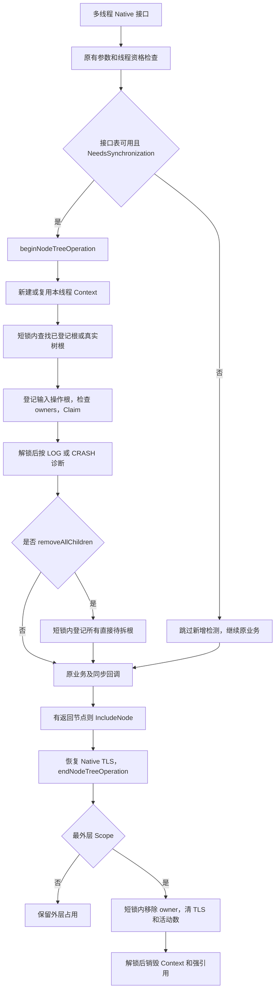
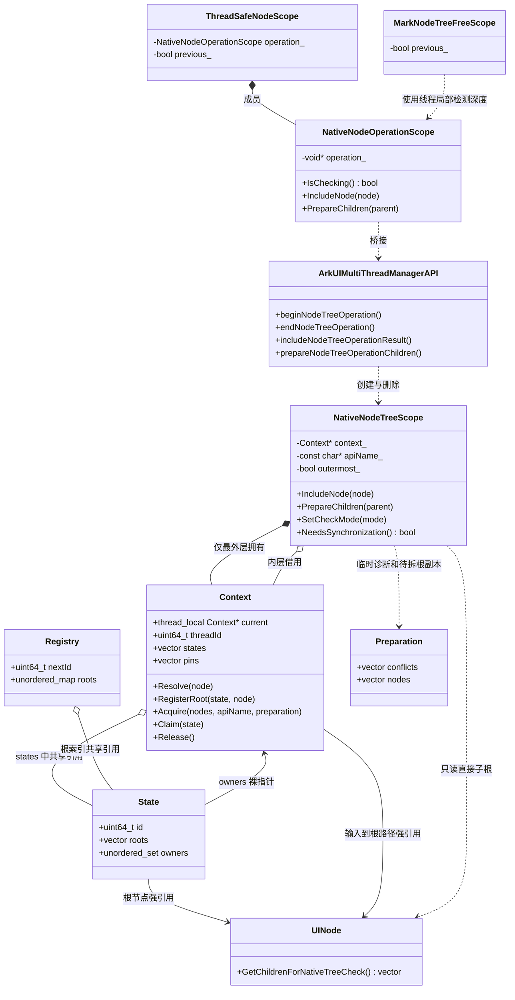
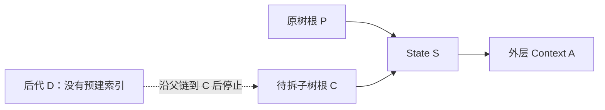
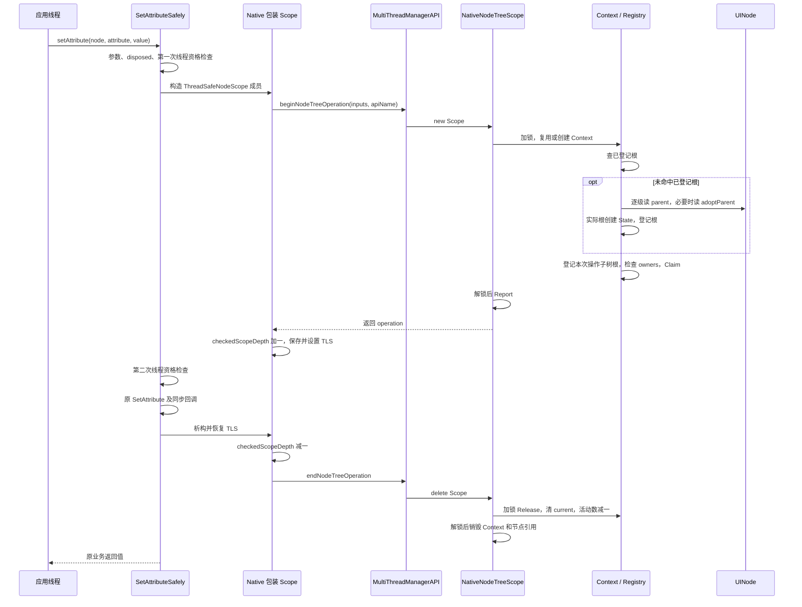
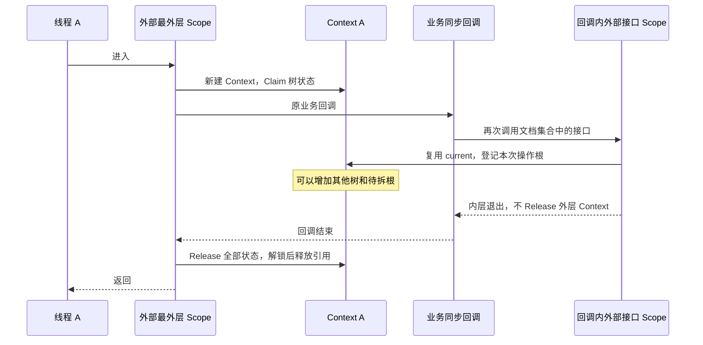
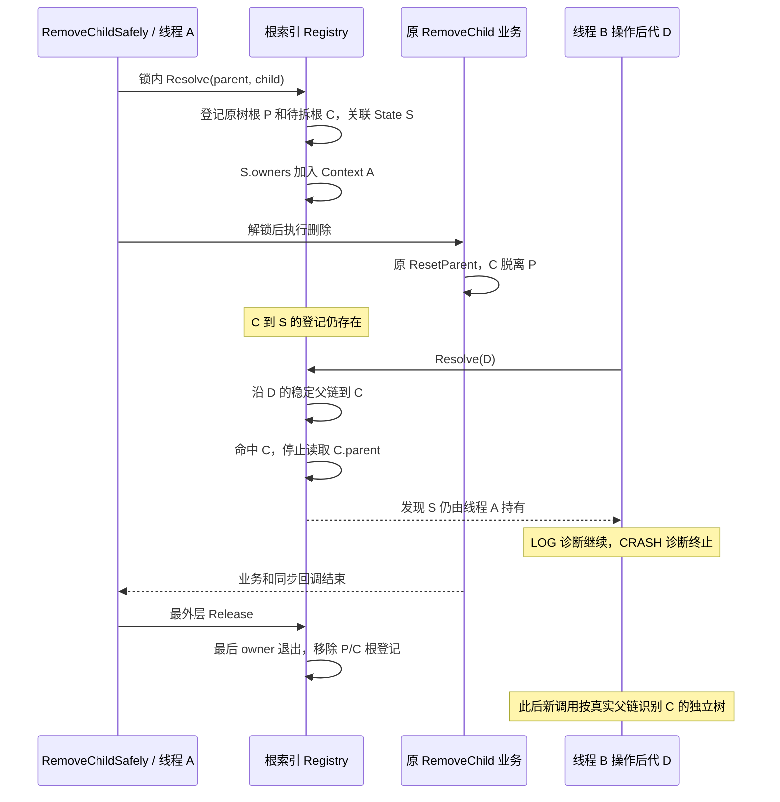
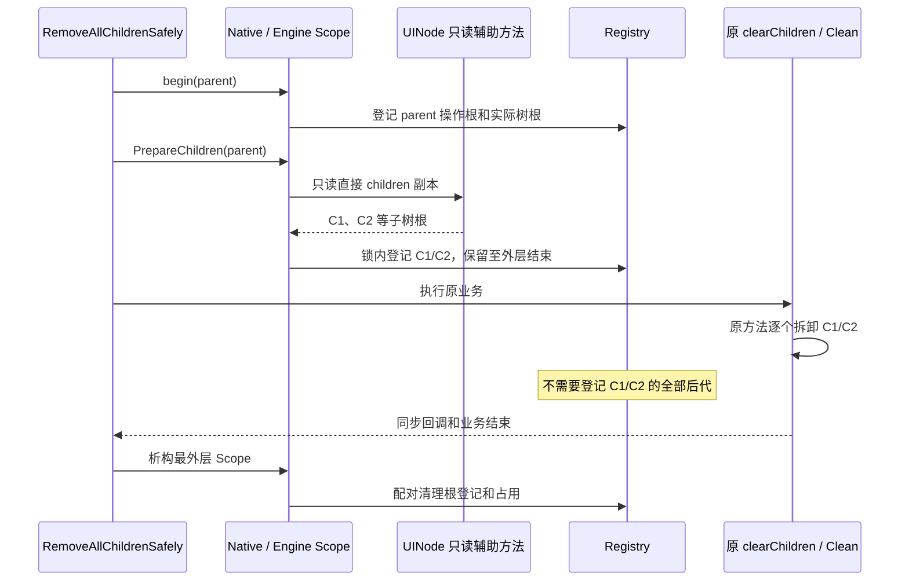
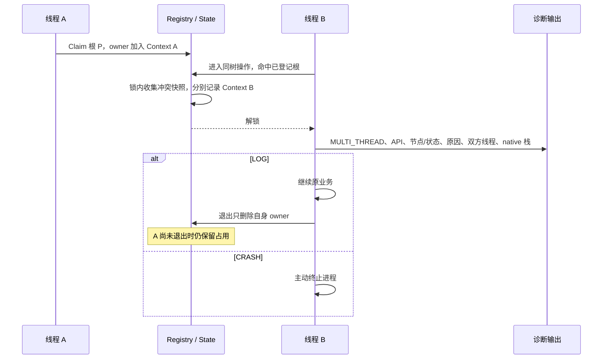
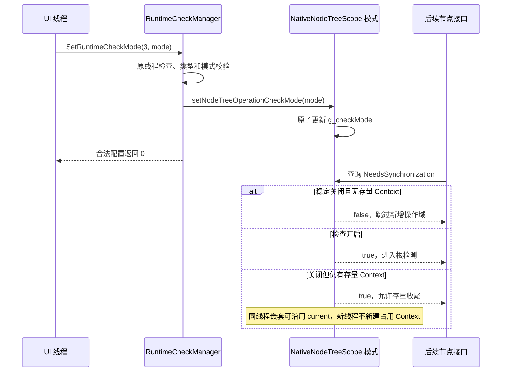

# NDK 同树并发检测：树根方案、类图与调用时序

> 更新日期：2026-10-24。基于分支 `ui_tree_api_check_v2` 的当前树根实现；最新 master 已合入。
> 本文的 Mermaid 图说明当前代码，不适用于已撤下的每节点 Association、全树成员快照或 UINode 父关系通知方案。
> 源码链接相对本文路径，行号对应本次整理时的代码。

## 1. 范围和修改原则

本特性检测通过 `ARKUI_MULTI_THREAD_NATIVE_NODE` 获取的节点接口对同一棵 Free 树的跨线程重叠调用。入口范围以 [NDK 多线程创建组件文档](https://gitcode.com/openharmony/docs/blob/master/zh-cn/application-dev/ui/ndk-build-on-multi-thread.md) 为准。既有线程资格、参数检查、返回码继续生效。

当前实现遵循：

- 只在上述外部接口建立操作域，覆盖原业务及其同步回调。
- UINode 的构造、析构、释放、SetParent、ResetParent、Free 标志读写等原有方法保持 master 原实现。
- UINode 只新增非虚只读方法 `GetChildrenForNativeTreeCheck()`，返回 `children_` 的直接子节点引用副本，不调用虚 GetChildren，不修改树。
- 不遍历全局 `g_nodeSetSafely`，不抓取全部已发布句柄，不给每个树成员建立占用映射。
- 占用索引记录实际树根、外部接口输入/返回的操作子树根，以及批量删除前预告的直接子树根。
- 同线程嵌套共享外层 Context；活动引用与占用在最外层退出时收尾。
- LOG 输出诊断后继续，CRASH 输出诊断后主动终止。检测器不等待业务 owner 释放。

源码入口：[接口集合](../../interfaces/native/node/native_impl.cpp#L159)、[Native 包装](../../interfaces/native/node/node_model_safely.cpp#L113)、[引擎检测器](../../frameworks/core/components_ng/base/native_node_tree_scope.cpp#L84)。

### 1.1 外部接口范围

`multiThreadNodeImpl_1` 有 40 个接口项。36 个涉及节点或创建节点的入口接入操作域；4 个全局接收器入口没有节点，不建立树操作域。

| 类别 | 接口 | 接入方式 |
|---|---|---|
| 创建/销毁 | createNode、disposeNode | 原包装域；创建成功后 IncludeNode 登记返回根 |
| 属性 | setAttribute、getAttribute、resetAttribute、setLengthMetricUnit | ThreadSafeNodeScope 成员建立操作域 |
| 节点事件 | registerNodeEvent、unregisterNodeEvent、addNodeEventReceiver、removeNodeEventReceiver | 同上 |
| 节点自定义事件 | registerNodeCustomEvent、unregisterNodeCustomEvent、addNodeCustomEventReceiver、removeNodeCustomEventReceiver | 同上 |
| 树修改 | addChild、removeChild、insertChildAfter、insertChildBefore、insertChildAt | 进入时登记相关输入的树根/子树根 |
| 批量删除 | removeAllChildren | 进入后 PrepareChildren，业务前登记所有直接待拆根 |
| 树查询 | getParent、getTotalChildCount、getChildAt、getFirstChild、getLastChild、getPreviousSibling、getNextSibling | 输入参与检测；返回节点的接口在返回前 IncludeNode |
| 自定义数据 | setUserData、getUserData | 仅新增 NativeNodeOperationScope，保留原 TLS 行为 |
| UI 线程限定的节点接口 | setMeasuredSize、setLayoutPosition、getMeasuredSize、getLayoutPosition、measureNode、layoutNode、markDirty | 保留原 UI 线程判断，再进入操作域 |
| 全局接收器 | registerNodeEventReceiver、unregisterNodeEventReceiver、registerNodeCustomEventReceiver、unregisterNodeCustomEventReceiver | 不建立树域；保留原 UI 线程约束 |

异步任务投递接口仍负责调度，本特性不把整个异步任务当成一个占用域；任务实际调用节点接口时才进入对应操作域。

### 1.2 “只记录根”具体是什么意思

不是只允许记录整棵树中“没有父节点”的节点。索引包含三类根：

| 类型 | 示例 | 为什么保留 |
|---|---|---|
| 实际树根 | P→C→D 中的 P | 标识当前整棵树的占用 |
| 操作子树根 | setAttribute(D) 的 D，addChild/RemoveChild 的输入 child | 标识本次接口直接操作的子树；移动前先作为查找边界 |
| 待拆子树根 | removeAllChildren(P) 的每个直接 child | 子树拆出后仍关联外层占用 |

例如对 `P→C→D` 执行 `setAttribute(D)`，可登记 P 和 D，但不会预先登记中间 C、兄弟节点或整棵树的所有后代。查根过程中会强引用路径节点保活；**保活与占用索引登记不是同一件事**。

## 2. 总体流程

`NeedsSynchronization()` 的条件是“检查开启，或者仍有存量外层检测调用”。这不是整段业务互斥锁的开关。真实新调用是否创建 Context，还取决于本线程是否存在 current，以及当前模式。

## 3. 类图和数据结构

### 3.1 类图

Native 包装位于 `OHOS::Ace::NodeModel`；引擎 Scope、Context、State、Registry 位于 `OHOS::Ace::NG`。后三个结构定义在 cpp 中。

没有 NativeNodeTreeMutation、每节点 Association、全成员快照，也没有在 UINode 原方法中插入锁或通知。

### 3.2 字段对应关系

| 数据 | 对应谁/由谁持有 | 生命周期 |
|---|---|---|
| Native operation_ | 桥接返回的引擎 Scope 指针 | 本次 Native 包装调用 |
| Scope.context_ | 当前线程外层 Context；内层借用 | 最外层 Scope 创建和删除 |
| Context.current | TLS 裸指针，指向本线程外层 Context | 外层进入设置、退出清空；不是强引用 |
| Context.states | 外层曾经触及的 State 共享引用 | 内层返回后继续持有，外层退出清理 |
| Context.pins | 输入到根路径上的节点强引用 | 外层退出、解锁后释放；不为路径中间节点自动建索引 |
| State.roots | 实际根、操作子树根、预告待拆根的强引用 | 相关 owners 全部退出后释放 |
| State.owners | 当前持有该状态的 Context 裸指针集合 | Context 释放前删除自身 |
| Registry.roots | 根地址到 State 的进程内临时索引 | 只覆盖活动调用；State 最后 owner 退出时移除 |
| Preparation | 冲突值快照、批量删除的直接子根引用副本 | 单次准备阶段；锁外释放临时引用 |

源码：[Context/State/Registry:84](../../frameworks/core/components_ng/base/native_node_tree_scope.cpp#L84)、[根登记:102](../../frameworks/core/components_ng/base/native_node_tree_scope.cpp#L102)、[Release:183](../../frameworks/core/components_ng/base/native_node_tree_scope.cpp#L183)。

### 3.3 一个 State 可以关联多个根

拆树时不要求建立一份覆盖全部后代的新 State。可以让实际根 P 与待拆根 C 暂时关联同一 State：

C 后来脱离 P，不会撤销 `C→S`；外层 A 返回前，新线程沿 D→C 即可命中占用。最后一个 owner 返回后 P/C 索引一起删除，下一次再沿真实父链判断独立树。

### 3.4 锁和线程局部量

| 项目 | 用途 |
|---|---|
| GetTreeMutex 返回的全局递归互斥锁 | 短时保护查根、根登记、owners、持有集合及待拆根准备 |
| g_checkMode | 原子配置：-1 跟随应用 debug 属性，0 关闭、1 LOG、2 CRASH |
| g_activeCalls | 全局原子外层 Context 数量；关闭后存量调用仍需收尾 |
| THREAD_ID | 检测器分配的进程内逻辑线程编号，不是直接读取的 OS TID |
| g_emittingDiagnostics | TLS 日志重入保护，避免递归输出 |
| g_checkedScopeDepth | TLS Native 包装对象层数；不是节点数量、树 ownerDepth 或持锁深度 |

锁不覆盖整段业务和回调。不能把“锁内查根”理解成原有 SetParent/ResetParent 也使用这把锁；父链安全依靠第 6 节的提前根登记协议。

## 4. 正常接口时序：SetAttributeSafely

### 4.1 逐步说明

| 步骤 | 实现行为 | 源码位置 |
|---|---|---|
| 1 | 空参、disposed 检查，执行原第一次 checkNodeOnValidThread | [node_model_safely.cpp:388](../../interfaces/native/node/node_model_safely.cpp#L388) |
| 2 | 构造 ThreadSafeNodeScope；先构造成员 NativeNodeOperationScope | [node_model_safely.cpp:164](../../interfaces/native/node/node_model_safely.cpp#L164) |
| 3 | 判断 begin/needs 函数指针和 NeedsSynchronization，关闭且无存量域时跳过新增检测 | [node_model_safely.cpp:117](../../interfaces/native/node/node_model_safely.cpp#L117) |
| 4 | 提取最多三个非空输入 uiNodeHandle；本接口只有 node | [node_model_safely.cpp:122](../../interfaces/native/node/node_model_safely.cpp#L122) |
| 5 | begin 创建引擎 Scope；新建或复用线程 current Context | [node_api_multi_thread.cpp:122](../../frameworks/core/interfaces/native/node/node_api_multi_thread.cpp#L122)、[引擎:207](../../frameworks/core/components_ng/base/native_node_tree_scope.cpp#L207) |
| 6 | 短锁内 Resolve：先查根索引，未命中才读真实 parent/adoptParent；保活访问路径 | [native_node_tree_scope.cpp:109](../../frameworks/core/components_ng/base/native_node_tree_scope.cpp#L109) |
| 7 | 找不到父节点时创建 State，登记实际树根；随后登记本次输入操作子树根 | [native_node_tree_scope.cpp:128](../../frameworks/core/components_ng/base/native_node_tree_scope.cpp#L128)、[157](../../frameworks/core/components_ng/base/native_node_tree_scope.cpp#L157) |
| 8 | 按 State 去重，检查其他线程 owner，收集 Conflict 值快照 | [native_node_tree_scope.cpp:145](../../frameworks/core/components_ng/base/native_node_tree_scope.cpp#L145) |
| 9 | 在锁内 Claim，建立 Context/State 双向记账；多节点输入保留相关 owner 集合 | [native_node_tree_scope.cpp:170](../../frameworks/core/components_ng/base/native_node_tree_scope.cpp#L170) |
| 10 | 解锁后 Report：LOG 诊断后返回，CRASH 诊断后终止 | [native_node_tree_scope.cpp:230](../../frameworks/core/components_ng/base/native_node_tree_scope.cpp#L230) |
| 11 | Native operation 返回非空时增加 g_checkedScopeDepth | [node_model_safely.cpp:129](../../interfaces/native/node/node_model_safely.cpp#L129) |
| 12 | ThreadSafeNodeScope 保存原 TLS 标志并设置 threadSafe=true | [node_model_safely.cpp:169](../../interfaces/native/node/node_model_safely.cpp#L169) |
| 13 | IsChecking 时执行第二次线程资格检查，再进入原 SetAttribute | [node_model_safely.cpp:388](../../interfaces/native/node/node_model_safely.cpp#L388) |
| 14 | 原业务及同步回调执行；内部方法不独立创建此检测域 | Native 原业务路径 |
| 15 | ThreadSafeNodeScope 析构函数体先恢复 TLS，随后成员 operation_ 析构 | [node_model_safely.cpp:176](../../interfaces/native/node/node_model_safely.cpp#L176) |
| 16 | Native 层减少 g_checkedScopeDepth，再 end 引擎操作域 | [node_model_safely.cpp:135](../../interfaces/native/node/node_model_safely.cpp#L135) |
| 17 | 最外层锁内 Release，清 current、减少 g_activeCalls；锁外 delete Context，释放强引用 | [native_node_tree_scope.cpp:276](../../frameworks/core/components_ng/base/native_node_tree_scope.cpp#L276) |

第一次线程检查保留原错误返回顺序。第二次检查再次确认进入操作域后的 Free/线程资格；稳定关闭状态不会新增执行第二次检查。原线程资格判定见 [multi_thread_build_manager.cpp:83](../../frameworks/core/common/multi_thread_build_manager.cpp#L83)。

### 4.2 正常调用时序图

下图假设检测开启、无冲突，且是本线程最外层调用。

构造函数中的 `return` 只跳过 NativeNodeOperationScope 的新增检测，不是外层 C API 返回；ThreadSafeNodeScope 原有标志设置及原业务仍继续。

## 5. 同线程嵌套和同步回调

同一 threadId 不构成冲突；同一 Context 对同一 State 只 Claim 一次。内层域仅借用 Context，退出不减少 ownerDepth；当前结构本身没有 ownerDepth 字段。

输入 `{ parent, child, sibling }` 表示三个相关参数，不是父、子、孙三层。三个输入各自所属树都参加占用判断；同树输入最终 State 去重。

## 6. 拆树、合树和父链读取协议

### 6.1 单节点拆树：RemoveChild

`RemoveChildSafely` 在执行原业务前，已用 parent、child 构造外部 Scope。child 会登记为操作子树根，因此不必在 UINode::ResetParent 内补协议通知。

关键时间点是“**先登记 C，再修改 C 的父链接**”。登记不能推迟到删除后或同步回调返回后。

### 6.2 批量拆树：RemoveAllChildren

本入口只有 parent 输入，不能仅登记 parent。Native 包装在业务前调用 PrepareChildren：

1. Scope 已登记 parent 所属树并完成入口冲突检查。
2. 短锁内通过新增只读方法取得 parent 的直接 children 副本。
3. 对每个直接 child 解析原状态、登记子树根并 Claim。
4. 解锁后执行原 clearChildren/Clean；不递归给全部后代建立占用索引。
5. 直接子树即使先后拆出，根登记也留到外层结束。

源码：[RemoveAllChildrenSafely:848](../../interfaces/native/node/node_model_safely.cpp#L848)、[PrepareChildren:255](../../frameworks/core/components_ng/base/native_node_tree_scope.cpp#L255)。

辅助方法只返回 `children_` 副本，不执行虚 GetChildren，也不会 LoadChildren、清缓存或改 disappearingChildren。用于当前文档接口的实际原生节点树路径，不能推导为覆盖任意内部语法节点的虚遍历行为。

### 6.3 合树：AddChild / InsertChild

进入时登记目标父树根、待插入 child 的原树根和 child 操作根。业务改父后，child 的旧根登记继续有效，目标父树也仍被同一外层 Context 持有。无需给所有后代迁移 State。

LOG 已存在其他 owner 时，当前 Acquire 将相关 owner 保留到本次多输入状态集合上，避免某一调用先结束后，另一活跃调用的合树占用被提前清除。原业务发生错误并发后的树结果仍不受安全保证。

### 6.4 为什么查根时不会继续读取正在修改的根父链接

外部接口进入与根登记在同一短锁内完成。每个会移动的外部输入子树根在原业务之前成为查找边界；批量拆树提前登记每个待拆根。

因此对 D→C→P，如果业务正在改 C.parent，查找先走 D 的稳定父链，到 C 后先查 Registry 并停止，不再读取 C.parent。其他线程在登记前进入时，写方还未开始原业务；写方进入后又会看到先前的占用。

这是一套“提前声明链接变更边界”的协议，**不是原 SetParent 使用了检测锁**。它依赖集合内树操作先登记输入/待拆根；不能在根方案中删掉 RemoveAllChildren 的预备步骤，也不能把任意未预告的内部直接改树宣称为已同步。

### 6.5 返回新节点

createNode 和节点查询接口在返回新句柄给应用前 IncludeNode。它登记返回节点这一操作子树根，沿用本线程 current Context。回调内创建或取得节点后，即使内层接口先返回，相关状态仍保留到最外层结束。

源码：[Native IncludeNode:143](../../interfaces/native/node/node_model_safely.cpp#L143)、[引擎 IncludeNode:242](../../frameworks/core/components_ng/base/native_node_tree_scope.cpp#L242)。

## 7. 冲突与释放

### 7.1 LOG / CRASH

Acquire 在锁内复制 API 名称、节点编号、状态编号、持有线程和模式，然后完成本 Context 的占用记账。解锁后同步输出诊断和 native 栈，CRASH 在原业务继续前主动终止。

LOG 不等待 owner、不跳过原业务，也不增加并发冲突返回码。它不保证错误并发的原业务安全；不能把诊断锁看成业务同步方案。根预告协议也不把非法 LOG 并发下原有容器读写变成线程安全。

### 7.2 最外层释放顺序

1. 内层 Scope 析构时 outermost_ 为 false，直接返回，继续保留外层持有集合。
2. 最外层在短锁内遍历 Context.states，从每个 State.owners 删除自己。
3. 某 State 还有其他 LOG owner 时，保留其所有根登记。
4. 某 State 的 owners 全空时，逐个移除 State.roots 对应的根索引。
5. 清除 TLS current，减少全局 g_activeCalls。
6. 释放短锁后删除 Context。根及路径的最后强引用可能触发原框架析构，这一步在锁外执行。

不能因为当前模式已关闭就跳过第 2～6 步，否则会留下 owner、引用或活动计数。

## 8. 开关、默认值及实时切换

配置通过 UI 线程上的 `OH_ArkUI_NativeModule_SetRuntimeCheckMode(MULTI_THREAD=3, mode)` 下发，保留原线程和参数校验。合法值 0/1/2 分别为 DISABLED/LOG/CRASH；未配置时按应用 debug 属性选择 CRASH 或 DISABLED。

源码：[配置下发](../../interfaces/native/node/config_manager.cpp#L58)、[引擎 SetCheckMode](../../frameworks/core/components_ng/base/native_node_tree_scope.cpp#L290)。

| 时段 | 当前行为 |
|---|---|
| 稳定 DISABLED、活动数为 0 | 不建 Context/State，不查树、不登记根、不抓全局节点、不获取新增协议锁，也不额外保活节点 |
| 关闭期间正常建树/换父 | 原 UINode 方法照常执行，无检测注册表要维护 |
| 从关闭切到启用 | 新调用沿当前真实父链定位，按需建立根状态；无须遍历所有节点补注册 |
| 开启切到关闭时已有外层域 | 旧域继续配对释放；PrepareChildren/同线程嵌套仍可沿用已有 Context |
| 关闭后又开启，而旧域仍未结束 | 保留的根仍可参与后续冲突检查 |

不追溯关闭期间已经开始的未检测调用，也不修复应用本身的错误并发。应用必须继续遵守同树串行规范，不能用切换开关为重叠操作建立同步关系。

桥接对象非空不严格等价于已登记 State。关闭收尾窗口中，其他线程可能得到一个 context_ 为空的桥接 Scope；创建接口也可能存在尚未登记树的空 Context。

## 9. Native TLS 变量的含义

### 9.1 `g_checkedScopeDepth`

这是 `thread_local uint32_t`，每个线程各自计数。NativeNodeOperationScope 获得非空 operation_ 时加一，析构时减一。当前读取它的地方是 MarkNodeTreeFreeScope：有检测包装域时保存并恢复原 `isNeedMarkNodeTreeFree`，支持同步嵌套。

| 调用时刻 | depth | Free 标记许可 |
|---|---:|---|
| 外层删除入口进入 | 1 | 保存原 false，设为 true |
| 内层删除入口进入 | 2 | 保存外层 true |
| 内层退出 | 1 | 恢复 true，外层许可仍有效 |
| 外层退出 | 0 | 恢复 false |

它不是 State ownerDepth、节点数或持锁深度，也不负责判断树冲突。树占用由 State.owners 决定；g_activeCalls 只统计全局外层 Context 数量。

### 9.2 `isNeedMarkNodeTreeFree()`

查询当前线程是否允许原业务把满足条件的可转换树重新标记为 Free。它不是节点自己的 isFree_，也不是 MULTI_THREAD 开关。

原 `UINode::MarkNodeTreeFree(bool)` 先检查：本次参数明确允许，或者线程许可为 true，才继续进行祖先、线程安全节点资格和子树条件检查。许可为 true 不代表无条件转换。

原逻辑见 [ui_node_multi_thread.cpp](../../frameworks/core/components_ng/base/ui_node_multi_thread.cpp#L69)。当前实现不修改该方法；Native 删除包装的 MarkNodeTreeFreeScope 在业务期间设置许可。

### 9.3 ThreadSafeNodeScope

原本就负责设置多线程建树标志。当前在有检测包装域时保存并恢复进入前的值，支持回调嵌套；稳定关闭时 previous_ 保持 false，保留原退出行为。

参数/资格检查与这两个 TLS 标志是不同机制，不能通过设置 threadSafe=true 豁免原有非 UI 操作 Attached 节点的限制。

## 10. 成本和覆盖边界

令 H 为父链高度、K 为批量删除的直接子根数：

- 普通接口主要沿至多三个输入的父链定位，最坏 O(H) 每个输入；命中已登记操作根时可提前停止。
- RemoveAllChildren 按 K 个直接待拆根准备，最坏 O(K×H)，不预建所有后代的占用项。
- 根索引大小与活动调用触及的不同操作根、待拆根数量相关。回调若显式触及许多节点，根数仍会随之增加。
- Context.pins 保留输入到根的路径引用，不是全树节点快照；不同进入路径可能重复保存引用。
- 所有调用会短时使用同一元数据锁，但原业务、公开回调和慢速 native 栈解析不在锁内。
- 检测只覆盖已接入外部接口及其预告的拓扑变化。内部任意未预告的父链接改写不属于“整个引擎都已检测”的承诺。

这版消除了全局 `g_nodeSetSafely` 扫描和逐树成员映射，但不能描述为“启用后零开销”或“所有内部改树都安全”。

## 11. 测试和验证入口

| 验证内容 | 当前测试/检查 |
|---|---|
| 同树不同节点、兄弟参照树冲突 | SameTreeDifferentNodesConflict、SiblingReferenceTreeAlsoConflicts |
| 异树并行与同线程重入 | IndependentTreesExecuteConcurrently、SameThreadReentryAndDuplicateInputsAreLegal |
| 内层返回后外层仍持有 | NestedCallRetainsNewTreeUntilOuterReturn |
| 单子树拆出前后 | SplitChildRemainsClaimedBeforeOuterReturn、SplitChildCanTransferAfterOuterReturn |
| 批量拆树 | RemoveAllPreparesEveryDirectSubtreeBeforeDetaching、RemoveAllRootsCanTransferAfterOutermostReturn |
| 真正重写父链接时的查根 | RootLookupStopsBeforeAnOperandWhoseParentIsChanging、LogLookupCanRunWhileAnAnnouncedRootChangesParent |
| 关闭兼容性与重新开启 | DisabledCallsDoNotRetainNodesOrTakeProtocolLocks、DisabledParentReleasePreservesOriginalChildDepth、EnablingFindsNodesCreatedAndReparentedWhileDisabled |
| 关闭中途的存量收尾 | DisableDrainsAnExistingScopeAndTracksItsSplits |
| LOG 各调用方独立释放 | LogContenderContinuesAndDoesNotClearOriginalOwner、LogPrimaryMayFinishBeforeContender |
| 缓存父链和无关节点保活 | CachedMembersOutsideOrdinaryChildrenRemainCovered、UnrelatedNodesAreNotRetainedForTheWholeCall |
| 配置类型、非法参数、默认值 | capi_runtime_check_test.cpp |
| UINode 原方法保持不变 | 从文件移除唯一新增辅助方法后，与 origin/master 逐字节比较 |

源码：[树根协议测试](../../test/unittest/core/base/native_node_tree_scope_test.cpp)、[配置测试](../../test/unittest/capi/runtime_check/capi_runtime_check_test.cpp)。

测试环境需分开理解：宿主隔离测试使用真实检测器和测试源码，UINode/平台环境使用桩；OHOS 交叉编译验证真实生产头文件与编译参数；完整 ace_engine 构建验证生产对象及动态库链接。宿主测试不替代设备上的页面、滚动和回调回归。

本次最终运行结果与构建日志另记录在 `/tmp/ace_tree_roots_only/verification.md`，不把旧版本的构建结果当作当前版本通过证据。
