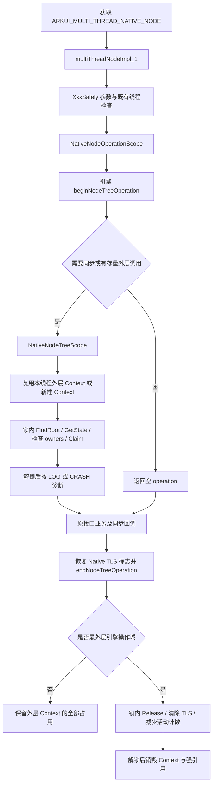
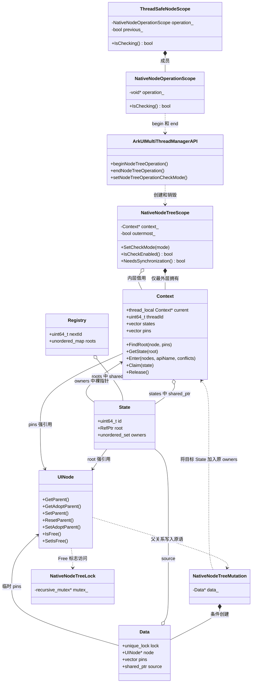
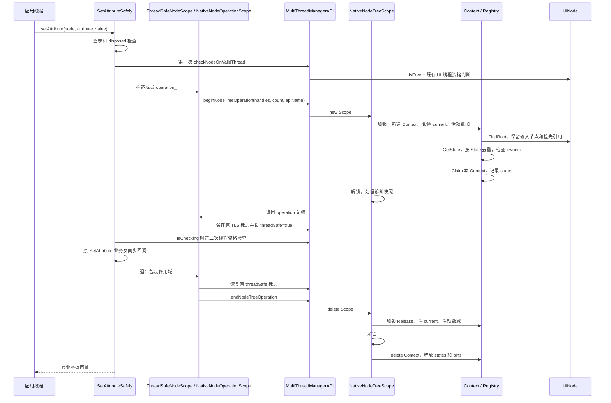
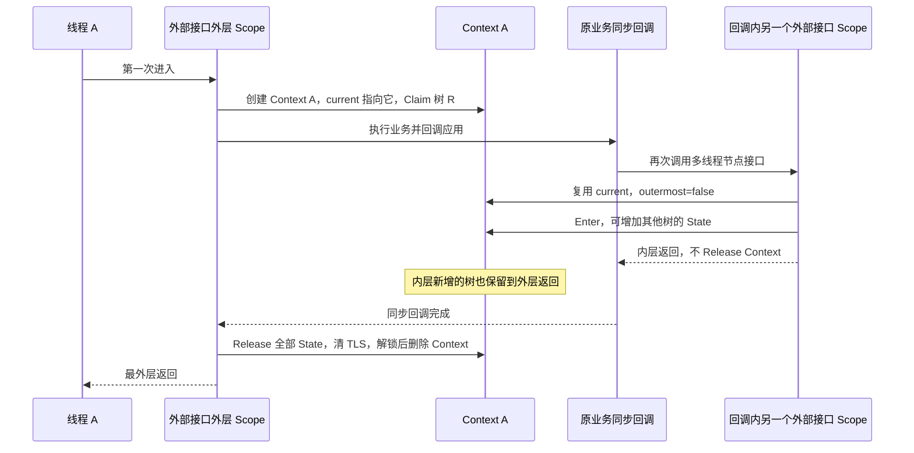

# NDK 同树并发检测 v2：修改流程、类图与调用时序

> 日期：2026-10-24。代码基线：分支 `ui_tree_api_check_v2`，实现提交 `05ff0ae231385f61b803a60a775efa6e26d2c24f`。
> 本文说明当前 `native_node_tree_scope.*` 实现。源码行号对应该提交；后续改动应重新核对。
> 图使用 Mermaid，可在支持 Mermaid 的 Markdown 阅读器中显示。

## 1. 本次修改解决什么问题

通过 `ARKUI_MULTI_THREAD_NATIVE_NODE` 获取的接口操作同一棵 Free 树时，要求应用串行调用，包括树上不同节点。检测启用后，外部接口记录本线程正在操作哪些树；另一线程重叠进入时按配置输出诊断或终止。

检测范围以 [NDK 多线程创建组件文档](https://gitcode.com/openharmony/docs/blob/master/zh-cn/application-dev/ui/ndk-build-on-multi-thread.md) 中的接口集合为边界。外层接口的同步回调也属于本次操作；内部布局、渲染、LazyForEach、Repeat 不独立创建检测操作域。

当前实现保留 UINode 的业务关系写入和生命周期逻辑，增加少量关系变更通知及 Free 标志同步。构造、析构、`MaybeRelease()`、`OnDelete()` 与 master 原实现一致。

### 1.1 入口范围

实际映射见 [native_impl.cpp:159](../../interfaces/native/node/native_impl.cpp#L159)，接口获取分支见 [native_impl.cpp:417](../../interfaces/native/node/native_impl.cpp#L417)。共 40 个接口项：36 个节点/创建入口接入操作域，4 个全局接收器入口没有节点，不建立树操作域。

| 类别 | 接口 | 操作域接入 |
|---|---|---|
| 创建与销毁 | createNode、disposeNode | 是；创建开始时尚无输入节点，操作域可以为空 |
| 属性 | setAttribute、getAttribute、resetAttribute、setLengthMetricUnit | 是 |
| 节点事件 | registerNodeEvent、unregisterNodeEvent、addNodeEventReceiver、removeNodeEventReceiver | 是 |
| 节点自定义事件 | registerNodeCustomEvent、unregisterNodeCustomEvent、addNodeCustomEventReceiver、removeNodeCustomEventReceiver | 是 |
| 树修改 | addChild、removeChild、insertChildAfter、insertChildBefore、insertChildAt、removeAllChildren | 是 |
| 树查询 | getParent、getTotalChildCount、getChildAt、getFirstChild、getLastChild、getPreviousSibling、getNextSibling | 是 |
| 自定义数据 | setUserData、getUserData | 是；保持原来不设置 ThreadSafeNodeScope 标志的行为 |
| 仅支持 UI 线程的节点接口 | setMeasuredSize、setLayoutPosition、getMeasuredSize、getLayoutPosition、measureNode、layoutNode、markDirty | 是；先保留原 UI 线程判断 |
| 全局接收器 | registerNodeEventReceiver、unregisterNodeEventReceiver、registerNodeCustomEventReceiver、unregisterNodeCustomEventReceiver | 否；保留原 UI 线程约束 |

`OH_ArkUI_PostAsyncUITask`、`OH_ArkUI_PostUITask`、`OH_ArkUI_PostUITaskAndWait` 负责调度任务；本实现没有把整个任务作为树占用范围。任务实际调用上述节点接口时进入相应操作域。

### 1.2 与旧方案的数据结构区别

| 内容 | 当前 v2 实现 |
|---|---|
| 每个 UINode 的 Association | 没有 |
| 节点构造注册、析构注销 | 没有新增逻辑 |
| 遍历子树迁移每个节点的 State | 没有；通过真实父链和新根 State 识别子树 |
| 提前拆除存活子节点的业务父关系 | 没有 |
| ownerThreadId / ownerDepth / additionalOwnerDepths | 使用 State.owners 中的外层 Context 集合代替 |
| 每个 State 的拓扑锁 | 没有；当前只有一把短时全局递归互斥锁 |
| 活动树状态 | 按需创建，最后一个持有 Context 返回后移出索引 |
| 关闭期间创建的节点 | 无须补注册；重新启用时沿真实关系找到根 |

## 2. 总体调用流程

图中“需要同步”的真实条件为 `IsCheckEnabled() || g_activeCalls != 0`。引擎构造函数还有本线程判断：关闭后，没有当前 Context 的新调用不会登记占用；已有 Context 的同线程嵌套仍可扩展持有集合。详见第 7 节。

源码：[桥接入口:121](../../frameworks/core/interfaces/native/node/node_api_multi_thread.cpp#L121)、[引擎构造:183](../../frameworks/core/components_ng/base/native_node_tree_scope.cpp#L183)、[NeedsSynchronization:237](../../frameworks/core/components_ng/base/native_node_tree_scope.cpp#L237)。

## 3. 类图与数据结构

### 3.1 类图

图中的 Native 类位于 `OHOS::Ace::NodeModel`；引擎类位于 `OHOS::Ace::NG`。`Context`、`State`、`Registry`、`Data` 是 cpp 内定义的实现结构。

源码：[Native 包装类:110](../../interfaces/native/node/node_model_safely.cpp#L110)、[引擎头文件:31](../../frameworks/core/components_ng/base/native_node_tree_scope.h#L31)、[Context/State/Registry:77](../../frameworks/core/components_ng/base/native_node_tree_scope.cpp#L77)、[Data:257](../../frameworks/core/components_ng/base/native_node_tree_scope.cpp#L257)。

### 3.2 每个对象对应谁

| 对象 | 对应关系 | 谁持有 | 何时释放 |
|---|---|---|---|
| NativeNodeOperationScope | 一个接入检测的 Native 包装调用 | 栈上对象，或 ThreadSafeNodeScope 的成员 | 包装调用退出 |
| NativeNodeTreeScope | 一个引擎桥接对象 | Native 层保存其 void*，通过 end 删除 | 对应包装调用退出 |
| Context | 一个线程当前最外层被检测调用 | 最外层引擎 Scope 使用 new/delete 管理；TLS current 只是裸指针 | 最外层 Scope 退出 |
| State | 某次解析得到的根对应的活动占用状态 | Registry 与一个或多个 Context 通过 shared_ptr 持有 | 索引移除且最后一个共享引用释放后 |
| Registry | 进程内活动状态索引 | 函数局部静态对象 | 进程生命周期；roots 条目只在活动期间存在 |
| NativeNodeTreeMutation::Data | 一次需要同步的父关系原语 | Mutation 临时对象 | 原语结束后，先解锁再释放临时引用 |

**不是每个 UINode 都对应 State。** 没有活动调用时，不为节点维护状态。一次外层调用可以持有多个 State；LOG 重叠时，一个 State 也可以有多个 Context owner。

### 3.3 Context 字段

| 字段 | 含义 |
|---|---|
| `current` | 当前线程最外层 Context 的 TLS 指针，不是强引用或所有者 |
| `threadId` | 检测器分配的进程内逻辑线程编号，不是直接读取的 OS TID |
| `states` | 当前外层调用曾经触及、必须保留至返回的 State 强引用集合；通过 Claim 去重 |
| `pins` | FindRoot 路径上的节点强引用，防止输入节点和祖先在调用期间释放；不同 Enter 之间可能重复保存引用 |

内层 Scope 的 `outermost_` 为 false，借用外层 Context。它退出时不会减少状态占用，也没有独立 ownerDepth 需要归还。

### 3.4 State 和 Registry 的重要细节

`State.root` 保存创建该状态时根节点的强引用。发生合树后，该节点可能已经有父节点，但旧 State 仍可被外层调用保留。因此，`Registry.roots` 不应理解为始终镜像当前树形结构的完整注册表。

每次 Enter 都先沿真实父链 FindRoot，再用得到的根查询 State。拆合树后可以同时保留历史 State 与当前根 State，直到相关外层调用结束。

`owners` 保存 Context 裸指针，访问受全局锁保护。Context 释放前先从它持有的全部 State 中删除自己，因此不会把一个 LOG 调用方退出误认为所有调用方都结束。

源码：[FindRoot:96](../../frameworks/core/components_ng/base/native_node_tree_scope.cpp#L96)、[GetState:117](../../frameworks/core/components_ng/base/native_node_tree_scope.cpp#L117)、[Claim:127](../../frameworks/core/components_ng/base/native_node_tree_scope.cpp#L127)、[Release:163](../../frameworks/core/components_ng/base/native_node_tree_scope.cpp#L163)。

### 3.5 锁和计数

| 项目 | 范围/用途 | 保护内容 |
|---|---|---|
| GetTreeMutex 返回的 recursive_mutex | 进程内一把短时锁 | 活动状态索引、owners、Context 持有集合、检测定位与父关系原语、Free 标志读写 |
| `g_checkMode` | 原子模式变量 | -1 跟随应用 debug 属性；0 关闭、1 LOG、2 CRASH |
| `g_activeCalls` | 原子活动外层调用计数 | 每次新建 Context 加一，最外层退出减一；用于关闭后的存量收尾 |
| `g_nextThreadId` / `THREAD_ID` | 全局原子编号分配器 / TLS 编号 | 区分调用线程 |
| `g_emittingDiagnostics` | TLS bool | 避免日志重入再次递归输出冲突诊断 |
| Native `g_checkedScopeDepth` | TLS 包装对象计数 | 辅助 Native TLS 恢复；与全局活动 Context 数量不是同一个概念 |

这把锁不覆盖整个业务调用，也没有为每棵树长期持有的业务互斥锁。LOG 继续业务后，不保证错误并发操作线程安全。

## 4. 正常属性接口时序：SetAttributeSafely

### 4.1 调用时序图

下图假设检测已启用、没有冲突，且本次是线程最外层调用。

### 4.2 每一步与代码位置

| 步骤 | 实际行为 | 代码 |
|---|---|---|
| 1 | 检查 node、disposed 状态，执行原有第一次线程资格判断 | [node_model_safely.cpp:366](../../interfaces/native/node/node_model_safely.cpp#L366) |
| 2 | 构造 ThreadSafeNodeScope；其成员 operation_ 先于构造函数体执行 | [node_model_safely.cpp:148](../../interfaces/native/node/node_model_safely.cpp#L148) |
| 3 | 忽略空 ArkUI_NodeHandle，提取 uiNodeHandle；最多传三个相关节点 | [node_model_safely.cpp:112](../../interfaces/native/node/node_model_safely.cpp#L112) |
| 4 | 桥接判断 NeedsSynchronization，必要时创建引擎 Scope | [node_api_multi_thread.cpp:121](../../frameworks/core/interfaces/native/node/node_api_multi_thread.cpp#L121) |
| 5 | 关闭且无线程当前 Context 时直接返回；否则锁内复用或新建 Context | [native_node_tree_scope.cpp:183](../../frameworks/core/components_ng/base/native_node_tree_scope.cpp#L183) |
| 6 | Enter 对每个节点沿 GetParent、必要时 GetAdoptParent 查根；不调用虚 GetChildren | [native_node_tree_scope.cpp:96](../../frameworks/core/components_ng/base/native_node_tree_scope.cpp#L96) |
| 7 | 获取/创建根 State，按 State 指针去重，检查是否存在其他逻辑线程 owner | [native_node_tree_scope.cpp:134](../../frameworks/core/components_ng/base/native_node_tree_scope.cpp#L134) |
| 8 | 把 Context 加入 owners，并把 State 保存到 Context.states | [native_node_tree_scope.cpp:127](../../frameworks/core/components_ng/base/native_node_tree_scope.cpp#L127) |
| 9 | 离开短锁后处理 Conflict 值快照；CRASH 在原业务前终止，LOG 继续 | [native_node_tree_scope.cpp:203](../../frameworks/core/components_ng/base/native_node_tree_scope.cpp#L203) |
| 10 | Native 包装保存原 threadSafe TLS，并设置为 true | [node_model_safely.cpp:151](../../interfaces/native/node/node_model_safely.cpp#L151) |
| 11 | 仅 IsChecking 为 true 时进行第二次线程资格检查 | [node_model_safely.cpp:375](../../interfaces/native/node/node_model_safely.cpp#L375) |
| 12 | 调用原 SetAttribute；同步回调继续位于外层作用域中 | [node_model_safely.cpp:379](../../interfaces/native/node/node_model_safely.cpp#L379) |
| 13 | ThreadSafeNodeScope 析构函数体先恢复 TLS；随后成员 operation_ 析构并 end | [node_model_safely.cpp:158](../../interfaces/native/node/node_model_safely.cpp#L158) |
| 14 | 最外层锁内删除自身 owner；owner 全空的 State 从 roots 移除；清 TLS 与计数 | [native_node_tree_scope.cpp:213](../../frameworks/core/components_ng/base/native_node_tree_scope.cpp#L213) |
| 15 | 解锁后 delete Context，释放节点/State 引用；可能触发的框架析构在锁外执行 | [native_node_tree_scope.cpp:224](../../frameworks/core/components_ng/base/native_node_tree_scope.cpp#L224) |

第一次检查保留原错误返回路径，避免本应先返回线程资格错误的调用提前参与检测。第二次检查用于再次确认进入操作域后 Free/线程资格仍满足原合同；不是把 Scope 当成整个业务期间的互斥锁。

现有线程资格实现见 [multi_thread_build_manager.cpp:83](../../frameworks/core/common/multi_thread_build_manager.cpp#L83)。它与同树占用检测是两个判断。

## 5. 同线程嵌套与同步回调

同线程不会因为 owners 中已有同一 threadId 而冲突。不同 State 在 Claim 时按 Context owner 去重。

内层 Scope 不独立占有 Context，也不使用引用计数延长 Context；外部接口使用正常同步栈式 RAII，外层生命周期覆盖内层。

插入接口传入父节点、子节点、参照兄弟节点，是为了覆盖三个相关输入各自所属的树。`node(0/1/2)` 是参数位置，不表示父、子、孙三个层级。父子兄弟最终解析到同一 State 时只登记一次。
